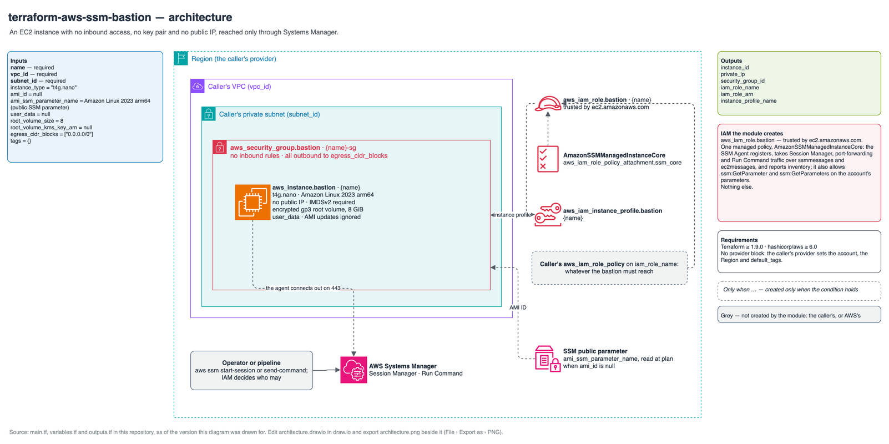

# Reference: names, tags and IAM

Every resource the module can create, when it is created, and the names it gets.
`<name>` is `var.name`. The instance and the security group also get `var.tags`; a
`Name` key in `var.tags` overrides their generated `Name` tag.

## Diagram

Source: [`architecture.drawio`](architecture.drawio).

## Resources

| Resource | Created when | Name or `Name` tag |
| --- | --- | --- |
| `data.aws_ssm_parameter.ami[0]` | `ami_id` is null | Reads `ami_ssm_parameter_name` (default `/aws/service/ami-amazon-linux-latest/al2023-ami-kernel-default-arm64`) |
| `data.aws_partition.current` | Always | Partition for the managed-policy ARN |
| `aws_security_group.bastion` | Always | Name prefix `<name>-` (AWS appends a unique suffix); tag `<name>-sg`; description `SSM bastion - egress only, no ingress` |
| `aws_iam_role.bastion` | Always | Role `<name>`; tags `var.tags` only, no `Name` tag |
| `aws_iam_role_policy_attachment.ssm_core` | Always | Attaches `arn:<partition>:iam::aws:policy/AmazonSSMManagedInstanceCore` |
| `aws_iam_instance_profile.bastion` | Always | Instance profile `<name>`; no tags |
| `aws_instance.bastion` | Always | `<name>` |

## Security group rules

| Direction | Rule |
| --- | --- |
| Ingress | None |
| Egress | One rule: all protocols and ports to `egress_cidr_blocks` (default `0.0.0.0/0`), description `Allow all outbound: Systems Manager, package repositories and the targets the bastion reaches` |

The rules are inline in `aws_security_group.bastion`, so the module owns the group's
egress: an egress rule added to the group elsewhere is removed on the next apply. An
ingress rule added elsewhere is not removed, but defeats the module's purpose.

## Instance settings

| Setting | Value | Input |
| --- | --- | --- |
| AMI | `ami_id`, else the value of the SSM parameter at creation. Later changes are ignored | `ami_id`, `ami_ssm_parameter_name` |
| Instance type | `t4g.nano` (arm64) | `instance_type` |
| Public IPv4 address | None | — |
| Key pair | None | — |
| Instance metadata | IMDSv2 required (`http_tokens = "required"`), endpoint enabled | — |
| Root volume | Encrypted gp3, 8 GiB, account's default EBS key | `root_volume_size`, `root_volume_kms_key_arn` |
| User data | None | `user_data` |

Changes that stop and start the instance: `instance_type`, `user_data`. Changes
that replace it: `subnet_id`, `root_volume_kms_key_arn`. Changing `vpc_id`
replaces the security group; the instance then needs a subnet in the new VPC, which
replaces it too.

## IAM granted by the module

The instance role is the only IAM the module creates.

| | |
| --- | --- |
| Trusted principal | `ec2.amazonaws.com` |
| Policies | The AWS managed policy `AmazonSSMManagedInstanceCore`, nothing else |

`AmazonSSMManagedInstanceCore` lets the SSM Agent register the instance, receive
Session Manager, port-forwarding and Run Command traffic over the `ssmmessages` and
`ec2messages` channels, and report inventory and association status; it also allows
`ssm:GetParameter` and `ssm:GetParameters` on every parameter in the account and
Region.

That last grant includes `SecureString` parameters encrypted with the AWS managed
key `aws/ssm`. Encrypt parameters the bastion must not read with a customer managed
key whose policy does not admit the `iam_role_arn` output.

## Permissions the caller needs

To apply the module, the caller's credentials need:

- EC2: run, describe, modify, stop, start and terminate instances, create tags;
  create, describe and delete security groups, and authorise and revoke their
  egress rules.
- IAM: create, read, tag and delete the role and the instance profile; attach and
  detach the managed policy; add the role to and remove it from the profile; and
  `iam:PassRole` on the role, for `ec2.amazonaws.com`.
- `ssm:GetParameter` on the AMI parameter, when `ami_id` is null.
- With `root_volume_kms_key_arn`: `kms:CreateGrant`, `kms:Decrypt`,
  `kms:DescribeKey`, `kms:GenerateDataKeyWithoutPlaintext` and `kms:ReEncrypt*` on
  the key.

To use the bastion: `ssm:StartSession` on the instance and on the session document
(`SSM-SessionManagerRunShell` for a shell, `AWS-StartPortForwardingSessionToRemoteHost`
for port forwarding), `ssm:TerminateSession` on your own sessions, and
`ssm:SendCommand` for Run Command.

## Requirements

| | Minimum | Why |
| --- | --- | --- |
| Terraform | 1.9.0 | The floor shared by this family of modules |
| `hashicorp/aws` | 6.0 | First release of the current major; the module uses no newer argument |
| AWS CLI (your machine) | 2, with the Session Manager plugin | `aws ssm start-session` |

Inputs and outputs are listed in the [README](../../README.md#inputs).
